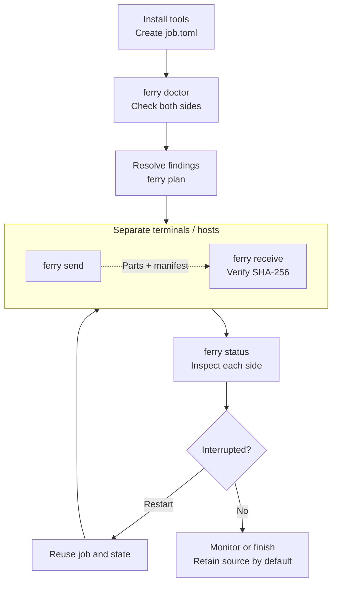

# Ferry

Ferry moves bulk data between disconnected hosts through cloud storage or a
shared directory. With SSH connectivity, it can use an rsync landing directory.
The Python 3.11+ CLI has no runtime Python dependencies; cloud and SSH adapters
use separately installed backend tools.

## How transfers work

A job groups source paths into **units**: tar archives or raw files, split into
parts if needed. The sender uploads parts, then `manifest.json` to mark readiness.
The receiver verifies sizes and SHA-256, places the result, and removes relay data.

- Resume uses per-host ledgers, sender staging, and verified receiver parts.
- Read windows and space limits help control source load and relay occupancy.
- Follow mode discovers new units and detects some source changes.

**The relay is temporary transport, not a backup.** Use dedicated relay and
destination paths, retain sources with `delete_source = "never"`, and verify
recovery before considering automatic source deletion.

## CLI workflow

Run sender and receiver in separate terminals or on their respective hosts;
you do not need to wait for sending to finish before receiving. In particular,
`after_receiver_ack` can keep the sender waiting for receiver verification.
Use `--once` only when one receiver pass is intended. For continuous jobs, start
both sides with `--follow` and leave those processes running rather than starting
duplicate senders or receivers. See
[Operations](operations.md) for preflight side effects, follow mode, source
deletion policies, and destination replacement behavior.

| Stage | What to do |
|---|---|
| Prepare | Install the required tools and run `ferry init`, or write a job from a reviewed example. |
| Inspect | Run doctor for both sides, resolve findings, then review the source units with plan. |
| Transfer | Run send and receive on the correct hosts with matching job/relay settings. |
| Monitor | Read each side's status on its own host; verification happens inside receive. |
| Resume | Reuse the same job, ledgers, staging and relay prefix; do not delete state to restart. |

## Start here

1. [Getting started](getting-started.md): install and try an isolated local relay.
2. [Configuration](configuration.md): define units, limits, and backend adapters.
3. [Operations](operations.md): inspect progress, resume, and run unattended.
4. [Pueue](pueue.md): queue sender batches while a separate receiver keeps draining the relay.
